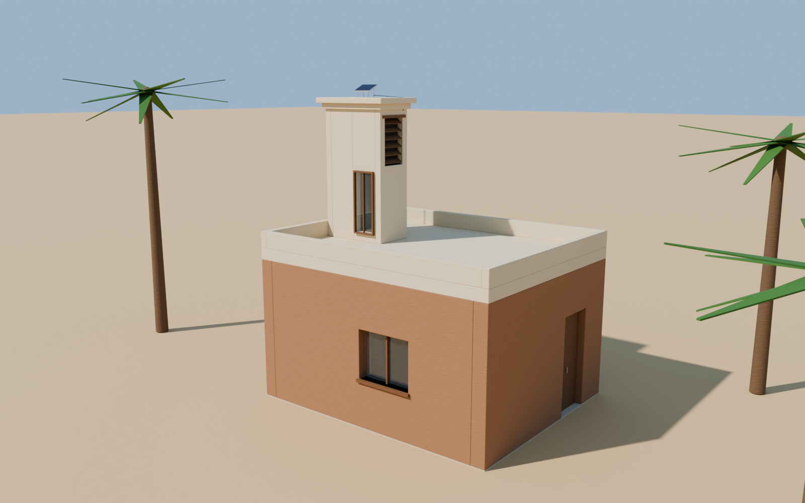
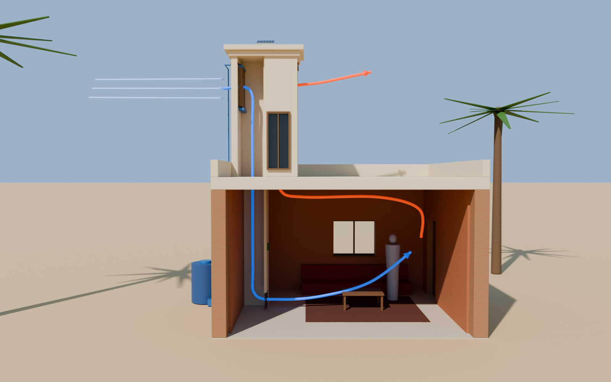
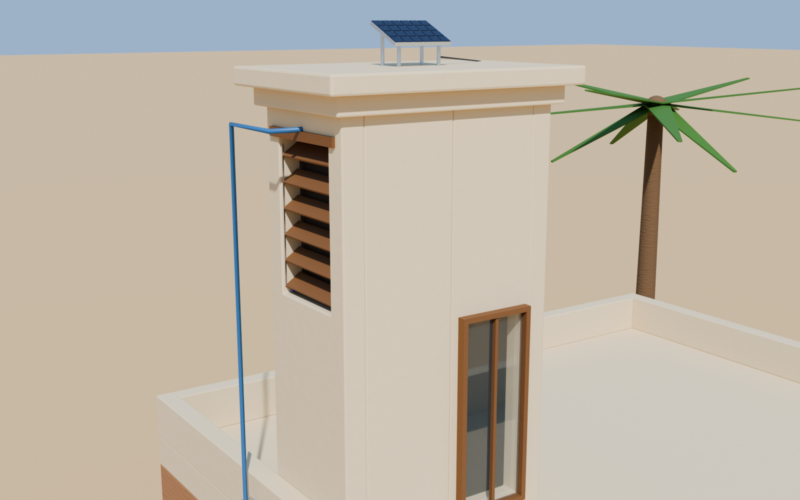

# EcoCatcher: 3D model for Blender

A parametric 3D model of the EcoCatcher windcatcher, built from the dimensions
in the study (Table 1). It has a two-shaft tower with 0.6 × 0.6 m shafts,
rising 3 m above a 3 m-high, 20 m² room, so the stack height H is 6 m. All six
upgrades are included, each in its own collection.

| Exterior | Section (cutaway hidden) | Tower detail |
|---|---|---|
|  |  |  |

## Files

| File | What it is |
|---|---|
| `EcoCatcher.blend` | Ready-to-open Blender scene with three cameras (saved with Blender 5.2, so it needs 5.x; on 4.2+ run the script instead) |
| `ecocatcher_model.py` | The Python (bpy) script that builds the whole model; change the parameters at the top and re-run it |
| `EcoCatcher.glb` | glTF export for the web, three.js, Unity, Unreal, SketchUp and other tools |
| `renders/` | Preview images rendered with Cycles |

## Open it in Blender

1. Install [Blender](https://www.blender.org/download/) 5.0 or newer.
2. **File → Open → `EcoCatcher.blend`**.
3. In the Outliner, toggle the collections on and off:

| Collection | Contents |
|---|---|
| Building | Rammed-earth walls, roof slab, parapet, door, windows |
| Tower | Two-shaft tower: intake (windward, west) and exhaust (leeward, east), divider, cornice, cap, supply and exhaust grilles |
| 1 Evaporative pad | Date-palm fibre pad, drip trough, collection tray, greywater tank, pump and feed pipe |
| 2 Solar chimney | Matte-black absorber behind glazing on the sunny (south) face of the exhaust shaft |
| 3 Solar fans | Three 140 mm 12 V fans in the exhaust shaft and a 10 W panel tilted 25° on the cap |
| 4 Smart louvers | Servo-driven timber louvers in both openings, ESP32 controller and temperature/humidity sensor |
| 5 Insect & dust mesh | Fibreglass mesh behind each louver bank |
| 6 Thermal-mass lining | 50 mm clay plaster on the inner wall faces and the ceiling |
| Interior | Floor cushion, low table, rug and a 1.75 m scale figure |
| Airflow | Diagram arrows: blue is the cooled supply, orange is the warm exhaust |
| Cutaway | South walls of the room and of the intake shaft. Hide this collection to see the section |

**Cameras:** *Exterior*, *Section* (hide *Cutaway* first) and *Tower detail*.
To look through one, select it and press **Numpad 0**.

**Conventions:** units are metres and Z is up. The wind blows from −X (west)
and the sun is to the south (−Y).

## Rebuild or change the design

The script rebuilds only the `EcoCatcher` collection and leaves the rest of
the scene alone.

- **Inside Blender:** in the *Scripting* workspace, open
  `ecocatcher_model.py` and click **Run Script**. To change the design, edit
  the parameters at the top first (`SHAFT`, `ROOM_X`, `TOWER_TOP`, `OPEN_Z0`,
  `LINING` and so on).
- **From the command line:**

  ```bash
  blender -b -P ecocatcher_model.py -- \
      --blend EcoCatcher.blend --glb EcoCatcher.glb --render renders --samples 96
  ```

- **Without installing Blender:** `pip install bpy`, then
  `python ecocatcher_model.py --blend EcoCatcher.blend ...` does the same
  thing. This is how the files in this folder were made.

## Connecting Claude to Blender live (optional)

If you want Claude to drive Blender directly on your own computer, you can use
the open-source [Blender MCP](https://github.com/ahujasid/blender-mcp) add-on:

1. In Blender, go to **Edit → Preferences → Add-ons → Install**, choose the
   add-on's `addon.py`, and enable it.
2. In the 3D Viewport sidebar (**N**), open the **BlenderMCP** tab and click
   **Connect**.
3. Add the MCP server to Claude Desktop, or to Claude Code running on that same
   machine, with the command `uvx blender-mcp`.

Claude can then open this model, change it and render it inside your running
Blender. This needs Claude and Blender on the same machine; a cloud session
cannot reach your local Blender.

## Notes

- The geometry is a design and communication model, not a construction
  drawing. The airflow arrows are schematic. For real flow fields, see
  Phase III of the study (CFD in OpenFOAM or SimScale).
- Procedural surface detail (earth strata, fibre texture) appears only in
  Blender renders. The `.glb` keeps flat base colours.
